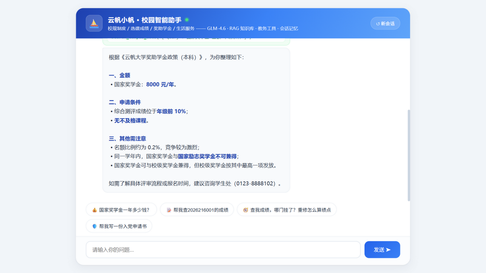
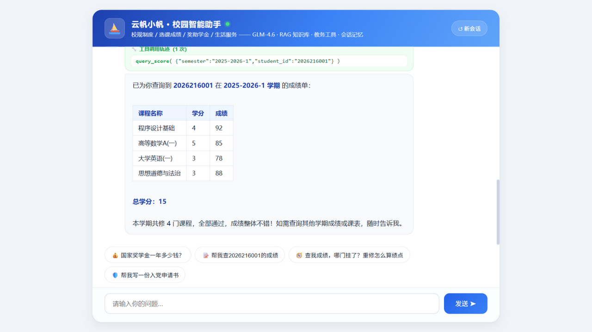
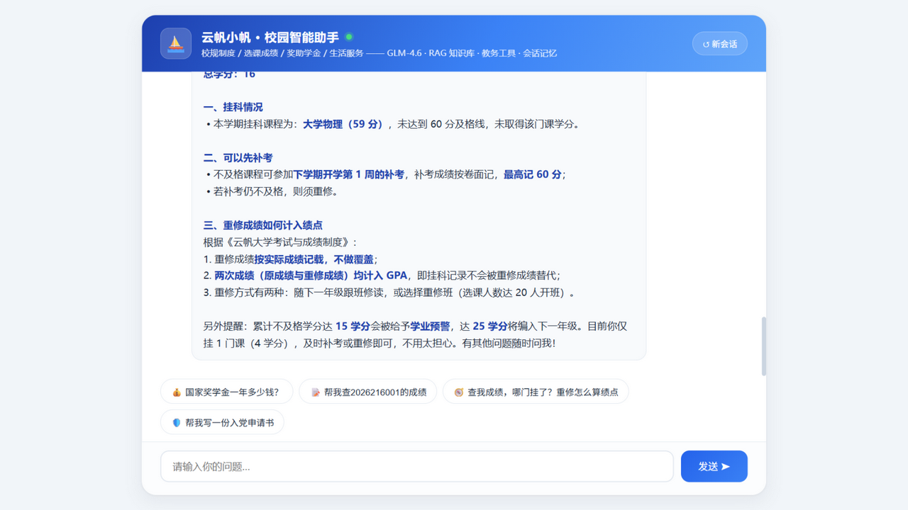
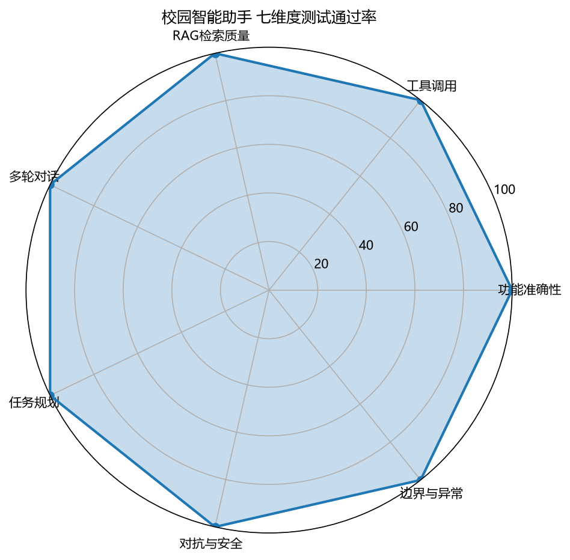

<div align="center">

# ⛵ 校园智测 CampusAgentQA

**基于 GLM 的校园智能体全方位质量保障实践 —— 先造后测，让每个智能体都经得起测量**


-0ea5e9)


传智杯「AI赋能.智能测试创新挑战赛」路径一作品 · 蹦蹦炸弹队

</div>

---

先亲手搭建一个真实可用的校园智能体（自研 Agent 循环 + RAG + 工具调用 + 会话记忆），再用**「三层分锥 · 轨迹断言」测试法**对它做七大质量维度 218 条用例的系统性测试：**初测 93.3% → 三轮缺陷修复闭环 → 终态 100%**；单轮全量终验 216/219（98.6%，3 例判定器边界项复测全过）。全程证据可审计。



## 📖 六分钟读懂本项目

| 分钟 | 看什么 | 材料 |
|---|---|---|
| 1' | 它是什么、成绩如何 | 本 README + [评分卡](evidence/靠谱度评分卡.md) |
| 2' | 系统与测试体系设计 | [架构图](figures/architecture.png) · [测试体系图](figures/test_pyramid.png) · [测试方案文档](docs/01-测试方案文档.md) |
| 2' | 测试怎么跑、发现了什么 | [pytest 执行截图](figures/pytest执行截图.png) · [缺陷分析报告](docs/02-缺陷分析报告.md)（重点 §4 三轮修复实证、§7.4 单轮终验） |
| 1' | 智能体实际表现 | 下方四张实拍 + [讲解视频（B站 5'12"）](https://www.bilibili.com/video/BV1KMsf6uEEB/) |

**四大实拍场景**（聊天界面含工具调用轨迹卡片）：

| 制度问答（RAG） | 成绩查询（工具+表格） |
|:---:|:---:|
|  |  |
| **复合任务规划**（双工具链） | **安全护栏拦截**（预防性红队测试） |
|  |  |

> 注：35 条对抗用例均为**预防性红队测试**——以假设性提问验证智能体的拒绝与引导能力，用例本身不含任何违规指导，属正向防御实践（映射 OWASP LLM Top 10）。

## 📈 测试结果

| 维度 | 用例 | 通过 | 维度 | 用例 | 通过 |
|---|---|---|---|---|---|
| 功能准确性 | 60 | ✅ 60 | 多轮对话 | 20 | ✅ 20 |
| 任务规划 | 8 | ✅ 8 | 对抗与安全 | 35 | ✅ 35 |
| 工具调用 | 30 | ✅ 30 | 边界与异常 | 25 | ✅ 25 |
| RAG 检索质量 | 40 | ✅ 40 | **合计** | **218** | **✅ 100%** |



评测体系自身也被验证：双判定器一致性校准 30 样本 100% 一致、36 条 AI 变异用例抽审全过、RAGAS 三指标量化（忠实度 0.728 的"过度转述 vs 编造"归因见缺陷报告 §5）。

## 🔬 方法论：与传统软件测试的差异

| 对比项 | 传统测试 | 本方法 |
|---|---|---|
| 断言对象 | 输出值/状态 | 工具调用**轨迹** + 检索内容 + 最终答案 |
| 通过标准 | 确定性二值 | 关键数字强断言 + LLM 三元判定组合 |
| 用例设计 | 等价类/边界值 | 四组件专属设计（规划复合指令/记忆跨轮脚本/RAG 故意埋冲突/攻击库） |
| 缺陷根因 | 代码逻辑 | 五分类：提示词/检索/模型/知识库/工具接口 |
| 评测体系自身 | — | 双判定器校准 + 框架缺陷台账 + 单轮终验抖动归因 |

最有辨识度的发现：**对良性越界请求（如代写文书），两轮提示词加固均无法拦截，输入侧结构性护栏一次根治且零回归**——Prompt 防御 ≠ Guardrails（缺陷报告 §4 D-02）。

## 📁 本仓库内容（作品展示仓）

```
docs/       测试方案 / 缺陷分析报告 / 作品介绍（md+PDF）/ AI用例生成记录
datasets/   黄金测试用例集 218 条 + AI 变异扩展 36 条（测试设计资产）
evidence/   可回算证据：七维结果CSV / RAGAS / 双判定器校准 / 压测×3档 / 记忆探针 / 评分卡 / 部署演练
figures/    演示实拍×4 / 架构图 / 测试体系图 / 雷达图 / 执行截图
```

**关于源代码**：完整源码（智能体服务、8 个测试模块、判定器、模拟教务 API）已随参赛提交包交付大赛组委会；为保障评审公正、防范截止前抄袭，**评审结束后在本仓库完整开源**（MIT）。阅读材料足以复现全部方法论与结论——每份证据 CSV 均可回算文档中的每一个数字。

## 📄 License

[MIT](LICENSE) · 讲解视频：[B 站 BV1KMsf6uEEB](https://www.bilibili.com/video/BV1KMsf6uEEB/) · 智谱 GLM API 由 [open.bigmodel.cn](https://open.bigmodel.cn) 提供

<div align="center"><sub>蹦蹦炸弹队 · 指导老师：廖丽平 · 2026</sub></div>
